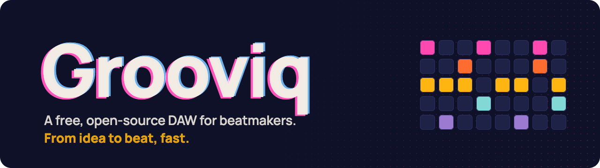
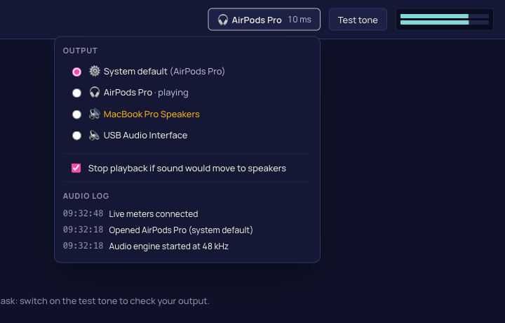
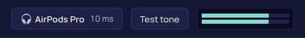
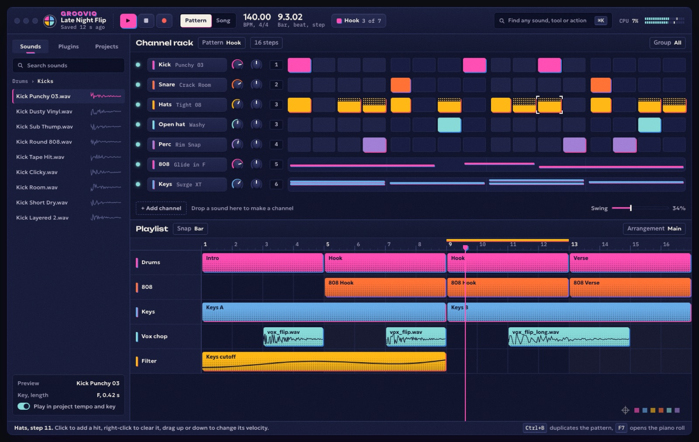
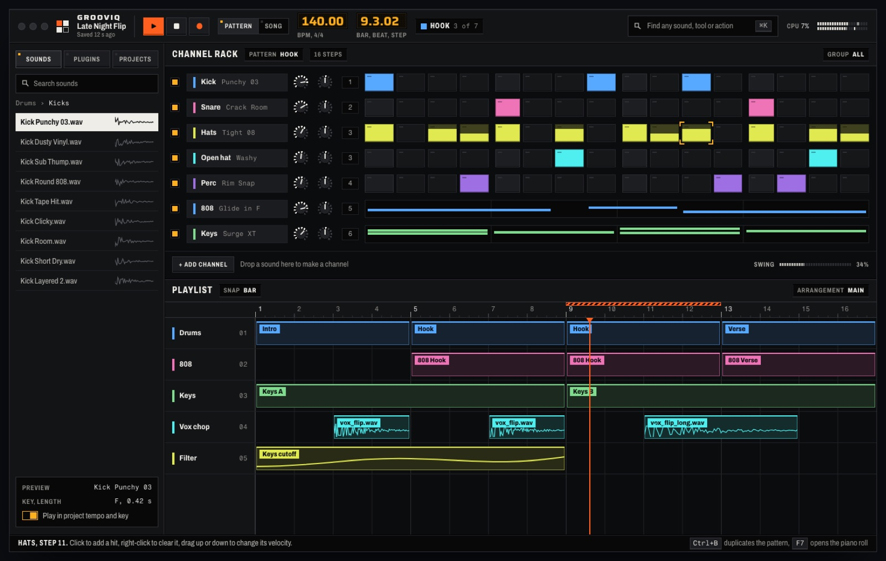
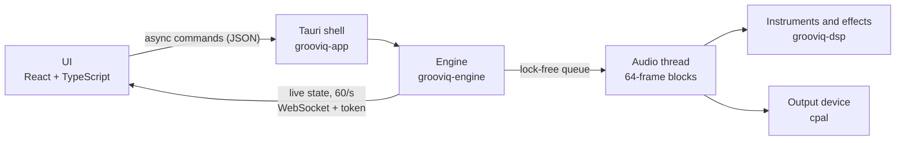

<p align="center">
  
</p>

<p align="center">
  <a href="https://github.com/YuriiMurha/grooviq/actions/workflows/ci.yml"></a>
  <a href="LICENSE"></a>
  
  
  
</p>

**Grooviq is a free, open-source desktop DAW for beatmakers.** It works the way FL Studio does (channel rack, step sequencer, piano roll, playlist, mixer), adds the best ideas from Ableton, and ships good built-in instruments and effects, so you can go from an idea to a finished beat without buying plugins.

> [!WARNING]
> **Pre-alpha.** You cannot make a beat with it yet. What exists today is the foundation: a real-time audio engine, safe output handling, a synth and effects, and the app shell. Follow the [roadmap](#roadmap) and the [issues](https://github.com/YuriiMurha/grooviq/issues).

## Why another DAW?

- **Free and open.** GPL-3.0, no subscriptions, no locked features, no account.
- **Fast from idea to beat.** The FL workflow beatmakers already know, with fewer windows and fewer clicks.
- **Batteries included.** Sampler, synths and the effects beatmakers reach for every day, built in, with your plugins (VST3 and CLAP) when you want them.
- **Safe by default.** Nothing plays until you ask, and the speaker guard stops playback if your headphones disconnect, so a beat never blares out of the laptop in a quiet office.

## What it looks like

The app today (milestone M0): the output chip follows your Mac's audio output, and the live meter runs at 60 frames per second.

<p align="center">
  <br>
  
</p>

Where it is going: interactive design mockups of the main window, in two of the built-in themes. These are mockups, not the current app.

<p align="center">
  
</p>

<details>
<summary>Another theme: Industrial</summary>
<p align="center"></p>
</details>

## Features

| Area | Today | Planned for version 1 |
| --- | --- | --- |
| Audio engine | Real-time-safe core in Rust: fixed 64-frame blocks, sample-accurate events, NaN guard, crash isolation, offline rendering | Multi-core mixing, plugin delay compensation |
| Output | Follows the system device, device picker, speaker guard, sample-rate changes, no-device handling | Output latency compensation for visuals |
| Instruments | Basic synth (7 presets), click-free | Sampler with slicing, drum pads |
| Effects | EQ, compressor, limiter, drive, reverb, delay, multiband, utility (DSP ready) | Mixer inserts, sidechain, clipper |
| Workflow | App shell, live meters, audio log | Channel rack, step sequencer, piano roll, playlist, mixer, browser |
| Plugins | | VST3 and CLAP hosting |
| Export | Offline render engine | WAV, MP3 and stems |

## Roadmap

| Milestone | What works at the end | Status |
| --- | --- | --- |
| M0 Foundation | Engine, output devices, live stream, golden tests, app shell, CI on macOS and Windows | ✅ Done |
| M1 First beat | Transport, channel rack, sampler, step sequencer, WAV export, save and load | ⏳ Next |
| M2 Notes | GPU piano roll, synth, MIDI keyboard input and recording | |
| M3 Song | Playlist with pattern, audio and automation clips | |
| M4 Mix | Mixer, inserts, sends, sidechain, core effects | |
| M5 Plugins | VST3 and CLAP hosting with their own windows | |
| M6 Version 1 | Browser, drum pads, undo, command palette, installers, first release | |

After version 1: better sampling (warping, slicing, stems), then sound design (modulators, racks, a wavetable synth and more effects).

## Try it

Grooviq has no release yet; you build it from source. You need [Rust](https://rustup.rs) (the pinned toolchain installs itself from `rust-toolchain.toml`), [Node.js](https://nodejs.org) 24 or newer, and on macOS the Xcode command-line tools.

```sh
git clone https://github.com/YuriiMurha/grooviq.git
cd grooviq
npm --prefix app/ui ci
npm --prefix app/ui run tauri dev
```

To build an installable app instead (macOS: `Grooviq.app` and a `.dmg`; Windows: an installer):

```sh
npm --prefix app/ui run tauri build
```

The bundles land in `target/release/bundle/`. Builds are not signed yet, so macOS asks you to confirm the first launch of a downloaded copy.

## How it is built



| Folder | What lives there |
| --- | --- |
| `dsp/` | `grooviq-dsp`: the synth and effects, allocation-free, tested for clicks |
| `engine/` | `grooviq-engine`: real-time core, output devices and speaker guard, live-state stream |
| `app/src-tauri/` | `grooviq-app`: the Tauri desktop shell |
| `app/ui/` | The React + TypeScript interface |
| `tests/golden/` | Golden renders: reference audio every change is compared against |

The audio thread never allocates, locks, logs or touches files; tests fail if it does. Every change runs on macOS and Windows CI, including bit-exact golden renders.

## Development

```sh
cargo test --workspace --all-features      # Rust tests (engine, DSP, golden renders)
cargo clippy --workspace --all-targets --all-features -- -D warnings
cargo fmt --all --check
npm --prefix app/ui test -- --run          # UI tests
npm --prefix app/ui run lint && npm --prefix app/ui run typecheck
```

`--all-features` turns on the engine's `test-hooks` feature; without it, the audio-health tests that inject a NaN or a panic do not run. No automated test plays sound through your speakers.

## Contributing

Issues are the plan: pick one from the [issue list](https://github.com/YuriiMurha/grooviq/issues), or open a new one with the bug or feature template. Pull requests run CI on macOS and Windows and are squash-merged. New code needs tests; audio code needs a test that would catch the problem it fixes.

## Licence

GPL-3.0-or-later. See [LICENSE](LICENSE). Grooviq's instruments and effects are original work; it does not use other products' names, presets, sounds or artwork.
